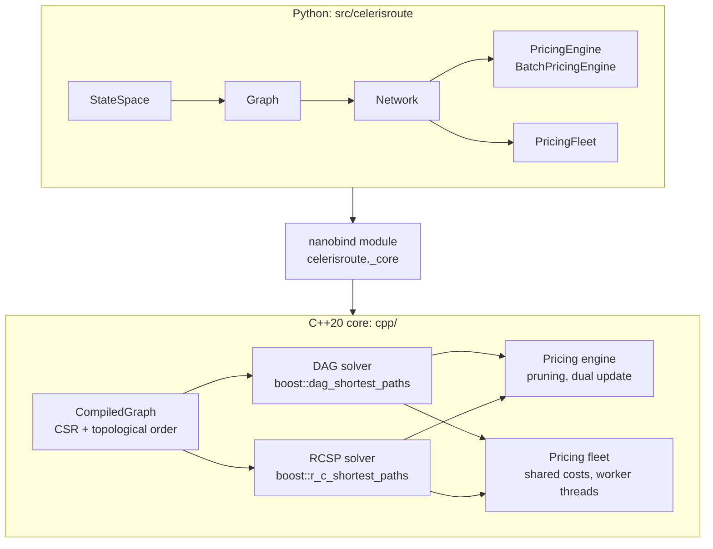

# Architecture

CelerisRoute is a thin, typed Python layer over a C++20 core. Python does the
modelling and the validation; C++ does everything that runs once per edge or
once per label.



## What happens where

| step | where | what |
|---|---|---|
| `StateSpace.id`, `ids` | Python + NumPy | mixed-radix encoding of states to dense ids |
| `Graph.add_edge(s)` | Python to C++ | validation, then append to edge arrays |
| `Graph.compile()` | C++ | counting sort into CSR, topological order, cycle witness |
| `Network.solve` | C++, GIL released | one solver call on a reusable workspace |
| `PricingEngine(...)` | C++ | prune to vertices between source and target, convert `A` to edge-major form |
| `engine.solve(duals)` | C++, GIL released | reduced costs, solve, path and coefficient reconstruction |
| `fleet.price(duals)` | C++, GIL released | one shared dual update, then all vessels on native threads |

Paths cross the boundary as NumPy arrays of vertex and edge ids. They are
decoded to states lazily, when you read `solution.path`.

## Boost, without copying

The solvers are the Boost Graph Library's `dag_shortest_paths` and
`r_c_shortest_paths`. Boost normally wants its own graph type; CelerisRoute
instead presents its compressed adjacency arrays to Boost through a small
adaptor (`bgl_adaptor.hpp`), so no second copy of the graph exists and the
pricing code can swap the cost array on each iteration.

Only header-only parts of Boost are used. Nothing is linked, and no Boost type
appears in the Python API.

## Source layout

```text
cpp/
  include/celerisroute/
    types.hpp            ids, CSR, statistics, result structs
    graph.hpp            GraphBuilder, CompiledGraph
    bgl_adaptor.hpp      presents the CSR to Boost.Graph without copying
    dag_solver.hpp       shortest path and K best paths on a DAG
    rcsp_solver.hpp      labels, dominance, completion bounds
    label_pool.hpp       reusable memory for labels
    pricing_engine.hpp   one subproblem, batch solve on std::thread
    pricing_fleet.hpp    shared reduced costs, vessel profiles, schedulers
  src/                   the matching .cpp files
  bindings/python.cpp    the nanobind module celerisroute._core
  bench/bench_core.cpp   native benchmark harness
src/celerisroute/        Python API: states, graph, resources, solvers,
                         pricing, fleet, results, errors
tests/                   pytest suite
examples/                runnable scripts
benchmarks/              benchmark scripts and their recorded results
docs/                    this site
```

## Extension points

Both solvers sit behind two functions, `solve_dag` and `solve_rcsp`, that take
a CSR, a cost array and a workspace. A custom labelling engine (bucketed
dominance, bidirectional search, label limits, K-best RCSP) can replace
`solve_rcsp` without touching the graph, pricing or Python layers.

New resource types need a new extension and dominance rule in
`cpp/src/rcsp_solver.cpp` and a new `sense` in
`src/celerisroute/resources.py`.

## Build

The build is CMake, driven by
[scikit-build-core](https://scikit-build-core.readthedocs.io/), with
[nanobind](https://nanobind.readthedocs.io/) for the bindings. The core is a
static library that does not depend on Python, which is what the native
benchmark harness links against:

```bash
cmake -S . -B build/bench -DCELERISROUTE_BUILD_PYTHON=OFF -DCELERISROUTE_BUILD_BENCHMARKS=ON
cmake --build build/bench
```
