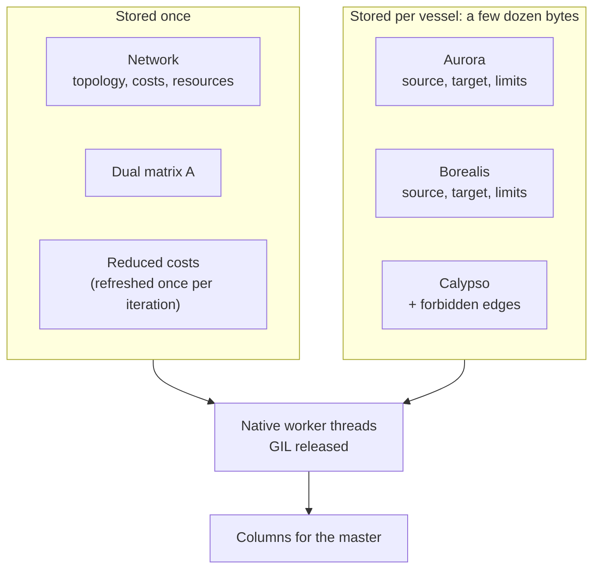

# Fleet pricing

A real planning problem rarely has one pricing problem. It has one per vessel,
truck or crew member, hundreds of them, and they are almost the same: the same
network, but a different start, a different tank, a few ports that are off
limits.

A [`PricingEngine`](pricing.md) per vehicle copies the network every time. A
`PricingFleet` keeps **one** network and **one** array of reduced costs, and
stores each vehicle as a small profile on top.



The API says *vessel* because the library grew out of maritime routing. A
vessel is any independent subproblem on the shared network.

## A small fleet

First the shared network: ports over sixteen days, where sailing burns fuel.
We remember which edges arrive where.

```python
import numpy as np
import scipy.sparse as sp
import celerispath as cp

DAYS = range(1, 17)
PORTS = ["Dubai", "Mumbai", "Singapore"]
SAILING_DAYS = {("Dubai", "Mumbai"): 3, ("Dubai", "Singapore"): 7, ("Mumbai", "Singapore"): 5}

states = cp.StateSpace(day=DAYS, port=PORTS)
graph = cp.Graph(states=states)
graph.add_resource(cp.Resource("fuel", upper=15))

arrivals = {port: [] for port in PORTS}          # edge ids, by port of arrival
for day in DAYS:
    for port in PORTS:
        if day + 1 in DAYS:
            graph.add_edge((day, port), (day + 1, port), cost=1)       # wait
        for other in PORTS:
            duration = SAILING_DAYS.get((port, other)) or SAILING_DAYS.get((other, port))
            if duration and day + duration in DAYS:
                edge = graph.add_edge((day, port), (day + duration, other),
                                      cost=10 * duration, resources={"fuel": duration})
                arrivals[other].append(edge)

network = graph.compile()
print(network)
# Network(num_vertices=48, num_edges=111, acyclic=True, resources=['fuel'])
```

The master has two demand rows, "call at Mumbai" and "call at Singapore",
followed by one row per vessel saying it sails at most one route:

```python
names = ["Aurora", "Borealis", "Calypso"]
num_rows = 2 + len(names)

rows = [0] * len(arrivals["Mumbai"]) + [1] * len(arrivals["Singapore"])
edges = arrivals["Mumbai"] + arrivals["Singapore"]
A = sp.csr_array((np.ones(len(edges)), (rows, edges)), shape=(num_rows, network.num_edges))
```

Now the fleet. Every argument of `add_vessels` takes one value per vessel:

```python
fleet = cp.PricingFleet(network, dual_matrix=A)
fleet.add_vessels(
    ids=names,
    source=[(1, "Dubai"), (1, "Dubai"), (1, "Mumbai")],
    target=[(16, "Dubai"), (16, "Dubai"), (16, "Mumbai")],
    resource_limits={"fuel": [15, 6, 15]},                    # Borealis has a small tank
    fixed_cost=[40, 25, 40],                                  # hire, paid per route
    fixed_coefficients=[{2 + v: 1.0} for v in range(3)],      # a 1 in the vessel's own row
    forbidden_edges=[None, None, arrivals["Singapore"]],      # Calypso may not call at Singapore
)
fleet.prepare()
print(fleet)
```

```text
PricingFleet(vessels=3, algorithm='rcsp', scheduler='threads', threads=10, cost_update='shared_sparse', num_constraints=5)
```

The scheduler and thread count depend on your build and machine.

## Pricing

One call folds the duals into the shared reduced costs and prices every
vessel:

```python
duals = np.array([100.0, 170.0, 0.0, 0.0, 0.0])
result = fleet.price(duals)

print(result.num_columns, result.converged)   # 3 False
print(result.best_reduced_costs)              # [-80.  -6. -37.]

for column in result.columns:
    ports = [column.path[0][1]] + [b[1] for a, b in zip(column.path, column.path[1:]) if a[1] != b[1]]
    print(f"{column.vessel:9s} cost {column.original_cost:5.0f}  reduced {column.reduced_cost:6.0f}  "
          f"fuel {column.resources['fuel']:2.0f}  " + " -> ".join(ports))
```

```text
Aurora    cost   190  reduced    -80  fuel 15  Dubai -> Mumbai -> Singapore -> Dubai
Borealis  cost    94  reduced     -6  fuel  6  Dubai -> Mumbai -> Dubai
Calypso   cost   163  reduced    -37  fuel 12  Mumbai -> Dubai -> Mumbai -> Dubai -> Mumbai
```

Three vessels, three different answers from one network: Aurora makes the
round trip, Borealis only reaches Mumbai on its small tank, and Calypso stays
away from Singapore.

### Straight into the master

The result is already shaped like the columns of a master problem:

```python
print(result.coefficient_matrix.toarray())
# [[1. 1. 2.]
#  [1. 0. 0.]
#  [1. 0. 0.]
#  [0. 1. 0.]
#  [0. 0. 1.]]
print(result.original_costs)   # [190.  94. 163.]
```

`coefficient_matrix` is a SciPy sparse matrix with one column per returned
route, so a column-generation round is three lines:

```py
M = sp.hstack([M, result.coefficient_matrix], format="csc")
costs = np.concatenate([costs, result.original_costs])
routes.extend(result.columns)
```

### When to stop

```python
duals = np.array([100.0, 170.0, -80.0, -6.0, -37.0])
result = fleet.price(duals)

print(result.num_columns, result.converged)   # 0 True
print(result.best_reduced_costs)              # [0. 0. 0.]
```

`result.converged` is true when every vessel was priced exactly and none has a
route with reduced cost below `-tolerance`. That is the proof that the
restricted master is optimal.

!!! warning "`converged` is false after an interruption"
    With `time_limit=...` or `fleet.cancel()`, some vessels may not have been
    priced. `converged` is then false and `all_priced_exactly` tells you why.
    Never stop column generation on "no columns returned" alone.

## What can differ per vessel

| argument of `add_vessels` | meaning |
|---|---|
| `source`, `target` | where the vessel starts and ends |
| `resource_limits` | its own upper bounds, replacing those of the network |
| `fixed_cost` | a cost per route, such as hire |
| `fixed_coefficients` | route-level master coefficients, such as the convexity row |
| `forbidden_edges` / `edge_mask` | edges the vessel may not use |
| `cost_offsets` | additions to edge costs, such as a more expensive fuel |
| `edge_coefficients` | vessel-specific coefficients on top of the shared matrix |

Only the differences are stored. A vessel without overlays costs a few dozen
bytes, and `fleet.memory` shows where the bytes go:

```python
print(fleet.memory["vessels"] < 1024)   # True: three vessel profiles
```

## Threads and schedulers

All vessels are priced on native threads with the GIL released, so the speed-up
is real on any Python build.

```py
cp.PricingFleet(network, dual_matrix=A, threads=4)           # default "auto": one per CPU
cp.PricingFleet(network, dual_matrix=A, scheduler="threads")  # or "tbb", default "auto"
```

| scheduler | what it is |
|---|---|
| `"threads"` | plain native threads that claim vessels from a shared counter; always available |
| `"tbb"` | a oneTBB work-stealing arena; only in builds with oneTBB, see `cp.tbb_available()` |

Both measured the same within noise in the
[fleet benchmark](../performance.md#fleet-pricing). Results are bit-identical
for every scheduler and thread count: vessels do not share mutable state, and
each one is solved by the same deterministic code.

## Faster dual updates

By default the duals are folded in with a sparse matrix product. When every
edge touches a small fixed number of master rows, known by index, you can skip
the sparse matrix entirely:

```py
mapping = cp.IndexedDuals(row=row_of_edge, coefficient=1.0)       # -1 means "no row"
fleet = cp.PricingFleet(network, dual_mapping=mapping)
```

`cp.PortTimeProductDuals` is the same idea for the common case of master rows
indexed by `(port, day, product)`; a dual array of that shape can then be
passed to `fleet.price` as it is.

## Engine or fleet?

| | `PricingEngine` / `BatchPricingEngine` | `PricingFleet` |
|---|---|---|
| network per subproblem | a pruned copy each | shared |
| subproblems on different networks | yes | no |
| peak memory, 125 vessels ([benchmark](../performance.md#fleet-pricing), 30 days) | 975 MB | 124 MB |
| setup time, same benchmark | 302 ms | 30 ms |
| K best paths per call | yes (DAG) | yes (DAG) |

Use engines for a handful of subproblems or when the networks differ. Use a
fleet when many subproblems share one network.

The complete loop is in [`examples/fleet_pricing.py`](../examples/fleet-pricing.md).
