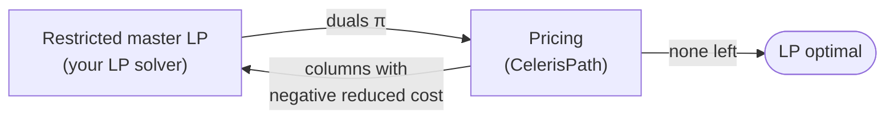

# Pricing with duals

Column generation solves a large linear program by keeping only a few of its
columns and asking a *pricing problem* for more. When a column is a path in a
network, the pricing problem is a shortest path with edge costs reduced by the
duals of the master. CelerisPath is built for exactly this loop.



## The setting

The master problem is a minimisation with one column per path \(P\):

\[
\min \sum_P c_P\, x_P \quad \text{s.t.} \quad \sum_P a_{kP}\, x_P \;\gtreqless\; b_k \;\; \forall k, \qquad x_P \ge 0
\]

A path collects its cost and its coefficients edge by edge:

\[
c_P = \sum_{e \in P} c_e, \qquad a_{kP} = \sum_{e \in P} A_{ke}
\]

so with duals \(\pi\) its reduced cost is again a path length:

\[
\bar c_P \;=\; c_P - \sum_k \pi_k\, a_{kP} \;=\; \sum_{e \in P} \Bigl( c_e - \sum_k \pi_k A_{ke} \Bigr)
\]

You supply the matrix \(A\) once. Each iteration you supply \(\pi\), and the
engine finds the path with the smallest reduced cost.

## A pricing engine

```python
import numpy as np
import celerispath as cp

states = cp.StateSpace(day=range(1, 4), port=["A", "B"])
graph = cp.Graph(states=states)
graph.add_resource(cp.Resource("fuel", upper=10))
graph.add_edge((1, "A"), (2, "A"), cost=1, resources={"fuel": 1})   # edge 0
graph.add_edge((1, "A"), (2, "B"), cost=5, resources={"fuel": 6})   # edge 1
graph.add_edge((2, "A"), (3, "B"), cost=9, resources={"fuel": 6})   # edge 2
graph.add_edge((2, "B"), (3, "B"), cost=1, resources={"fuel": 5})   # edge 3
network = graph.compile()

# One master row: "arrive at B on day 3". Edges 2 and 3 do that.
A = np.array([[0.0, 0.0, 1.0, 1.0]])

engine = cp.PricingEngine(network, (1, "A"), (3, "B"), dual_matrix=A)
```

`A` has one row per master constraint and one column per edge. Dense arrays
and SciPy sparse matrices both work; real models use sparse ones.

Building the engine does the expensive things once: it prunes the network to
the vertices between source and target, stores \(A\) in a form that is fast to
multiply, and allocates the solver workspace.

```python
result = engine.solve(np.array([12.0]))

print(len(result))                # 1
print(result.best_reduced_cost)   # -2.0

column = result[0]
print(column.original_cost)          # 10.0, the cost c_P for the master objective
print(column.reduced_cost)           # -2.0
print(column.path)                   # [(1, 'A'), (2, 'A'), (3, 'B')]
print(column.dense_coefficients())   # [1.], the column a_P for the master matrix
print(column.resources)              # {'fuel': 7.0}
```

A `Column` is everything the master needs: the objective coefficient, the
constraint coefficients (`coefficient_indices` and `coefficient_values` in
sparse form, `dense_coefficients()` as a vector) and the path itself for when
you turn the solution back into a plan.

## The convergence certificate

By default `solve` returns only columns that would improve the master, those
with reduced cost below `-tolerance`:

```python
result = engine.solve(np.array([4.0]))

print(len(result))                # 0
print(result.best_reduced_cost)   # 6.0
```

`best_reduced_cost` is the exact minimum over all feasible paths whether or
not a column comes back. When it is not negative for every subproblem, the
restricted master is optimal for the full problem. That is the stopping test
of column generation, and it is exact because the solvers are.

Pass `negative_only=False` to get the best path regardless of its sign, which
is handy for creating the first columns with all duals at zero.

## Dual signs

`duals` must be the usual LP duals of a minimisation problem: the change of the
optimal objective per unit of right-hand side. That means \(\pi_k \ge 0\) for
`>=` rows, \(\pi_k \le 0\) for `<=` rows, and free sign for `=` rows.

=== "SciPy / HiGHS"

    `scipy.optimize.linprog` accepts only `A_ub @ x <= b_ub`. If you pass a
    `>=` row as `-a @ x <= -b`, negate that row's marginal:

    ```py
    lp = linprog(costs, A_ub=-M, b_ub=-rhs)   # all rows are M x >= rhs
    duals = -lp.ineqlin.marginals
    ```

=== "Gurobi"

    The `Pi` attribute of a minimisation model already has the right sign:

    ```py
    duals = np.array([row.Pi for row in model.getConstrs()])
    ```

For a maximisation master, minimise the negated objective instead.

## Terms that do not live on edges

Some parts of a column belong to the route as a whole. The typical one is a
convexity row, "each vessel sails exactly one route", where every route of
that vessel has coefficient 1. Give those to the engine as fixed terms:

```py
engine = cp.PricingEngine(
    network, source, target,
    dual_matrix=A,
    fixed_cost=40.0,                          # added to every column's cost
    fixed_coefficients={vessel_row: 1.0},     # added to every column's coefficients
)
```

They are included in every `reduced_cost`, `original_cost` and coefficient
vector the engine returns.

## K best paths

On an unconstrained network the engine can return the `k` cheapest distinct
paths in one call, a cheap way to add several columns per iteration:

```py
engine = cp.PricingEngine(network, source, target, algorithm="dag", dual_matrix=A)
result = engine.solve(duals, max_paths=5)
```

The resource-constrained solver returns one path per call.

## Many subproblems

A fleet with three vessel types has three pricing problems per iteration.
`BatchPricingEngine` solves them on native threads with the GIL released:

```py
batch = cp.BatchPricingEngine([engine_a, engine_b, engine_c])
results = batch.solve_batch(duals)        # results[i] belongs to engines[i]
```

The results are identical to calling `engine.solve` one by one, whatever the
thread count. [`examples/column_generation.py`](../examples/column-generation.md)
uses this in a complete loop.

When many subproblems share **one** network and differ only in details such as
start, end or limits, a [`PricingFleet`](fleet.md) is the better tool: it
stores the network once instead of once per engine.
